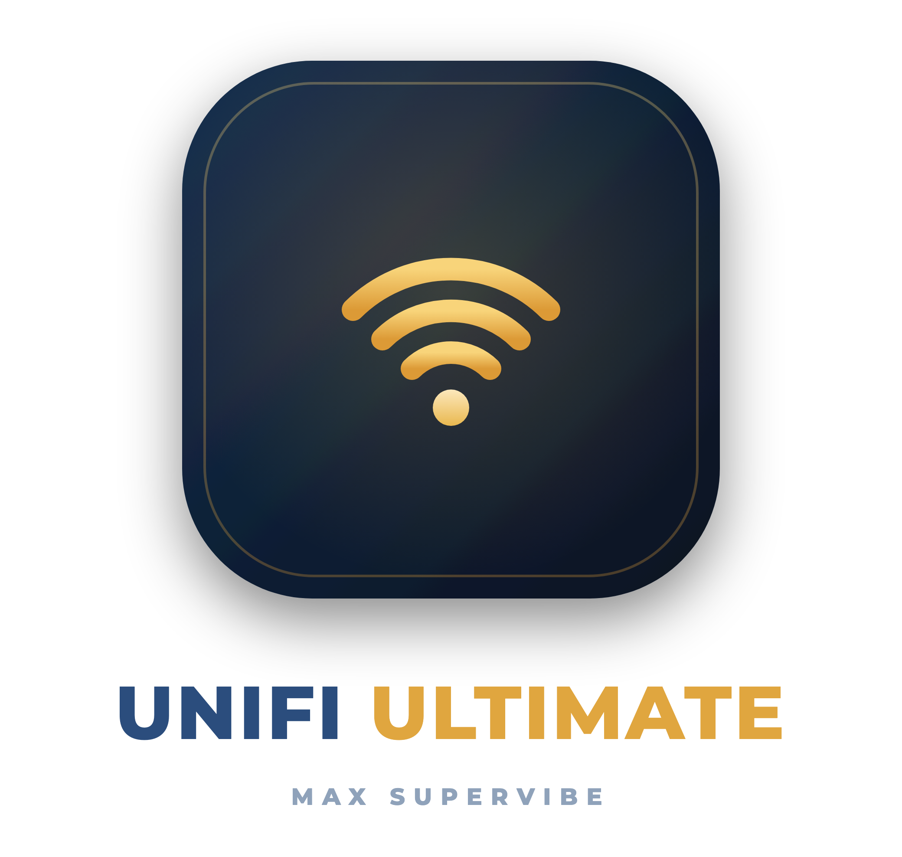

  

## The most italian Ubiquiti Unifi Nodes for Node-RED

Control and monitor your **UniFi Network**, **UniFi Protect**, and **UniFi Access** devices directly from Node-RED.
UniFi Ultimate brings the full power of the Ubiquiti UniFi ecosystem to Node-RED. Monitor and control UniFi Network, Protect, and Access using intuitive nodes, receive real-time events, manage devices, PoE ports, cameras, and client presence, and build powerful automation workflows without complex coding.

 
 
 

[![NPM version][npm-version-image]][npm-url]
[![Node.js version][node-version-image]][npm-url]
[![Node-RED Flow Library][flows-image]][flows-url]
[![Docs][docs-image]][docs-url]
[![NPM downloads per month][npm-downloads-month-image]][npm-url]
[![NPM downloads total][npm-downloads-total-image]][npm-url]
[![MIT License][license-image]][license-url]
[![Youtube][youtube-image]][youtube-url]

  

[View Changelog](CHANGELOG.md)

<a href="https://youtube.com/playlist?list=PL9Yh1bjbLAYrWKtMlopN0swuQXbdJ8MFJ&si=4MmW1nNTCLrJtEHv">
  Watch news and tutorials on YouTube
</a>

 
 

## Install

In Node-RED:

1. Open `Manage palette`.
2. Select `Install`.
3. Search for `node-red-contrib-unifi-ultimate`.
4. Install the package.

## 📘 Documentation

The full documentation is on **[maxsupervibe.com](https://www.maxsupervibe.com/docs/unifi-ultimate/)**, together with the help of every other Max Supervibe node.

  <a href="https://www.maxsupervibe.com/docs/unifi-ultimate/">📘 Go to the documentation</a>

Release notes: [CHANGELOG.md](CHANGELOG.md)

[npm-version-image]: https://img.shields.io/npm/v/node-red-contrib-unifi-ultimate.svg
[npm-url]: https://www.npmjs.com/package/node-red-contrib-unifi-ultimate
[node-version-image]: https://img.shields.io/node/v/node-red-contrib-unifi-ultimate.svg
[flows-image]: https://img.shields.io/badge/Node--RED-Flow%20Library-red
[flows-url]: https://flows.nodered.org/node/node-red-contrib-unifi-ultimate
[docs-image]: https://img.shields.io/badge/docs-documents-blue
[docs-url]: https://github.com/Supergiovane/node-red-contrib-unifi-ultimate#readme
[npm-downloads-month-image]: https://img.shields.io/npm/dm/node-red-contrib-unifi-ultimate.svg
[npm-downloads-total-image]: https://img.shields.io/npm/dt/node-red-contrib-unifi-ultimate.svg
[license-image]: https://img.shields.io/badge/license-MIT-green.svg
[license-url]: https://opensource.org/licenses/MIT
[youtube-image]: https://img.shields.io/badge/YouTube-Subscribe-red?logo=youtube&logoColor=white
[youtube-url]: https://youtube.com/playlist?list=PL9Yh1bjbLAYrWKtMlopN0swuQXbdJ8MFJ&si=4MmW1nNTCLrJtEHv
